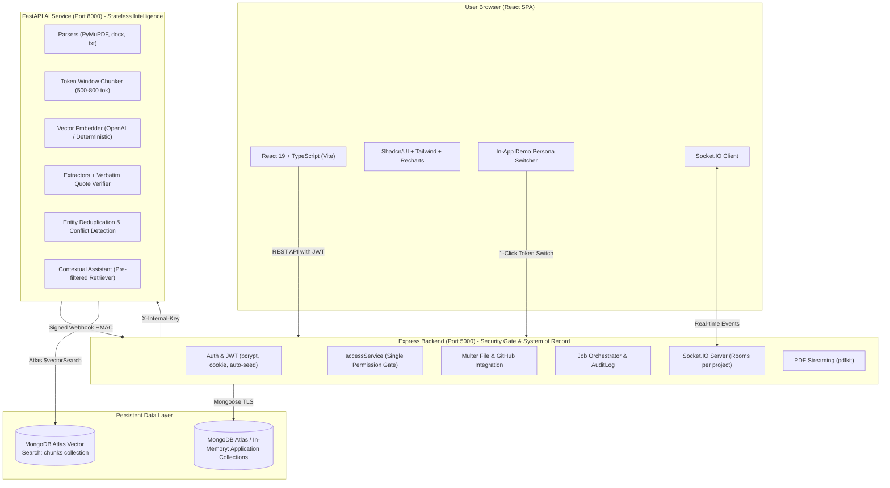

# Knowledge Handover Platform

> **Tagline:** Replace the Person, Not the Knowledge.

[](https://knowledge-handover.vercel.app/)
[](https://opensource.org/licenses/MIT)

🌐 **Live Application:** [https://knowledge-handover.vercel.app/](https://knowledge-handover.vercel.app/)

A production-style knowledge capture and transfer system for engineering teams. When a developer leaves a team, the platform collects unstructured project artifacts (documents, GitHub commits/issues/PRs, meeting discussions), extracts verified structured facts with verbatim evidence, detects contradictions (e.g. MongoDB vs PostgreSQL), and generates a human-reviewed, permission-aware handover report and interactive AI assistant.

---

## 1. Three Core Architectural Pillars

- **TRACEABLE:** Every assertion in a report, graph, or chat response links directly to a verbatim snippet quote in the underlying source chunk. Unsupported statements are dropped or labelled `"no_evidence"`.
- **ACTIONABLE:** The incoming engineer immediately sees completed vs pending work, ownership responsibilities, architectural decisions, system dependencies, active risks/blockers, and a grounded 5-day onboarding roadmap.
- **PERMISSION-AWARE:** Information is filtered at the database/retrieval query layer via `accessService`. Incoming team members cannot see or query restricted sources (e.g. executive compensation, private severance notes).

---

## 2. Architecture Diagram



---

## 3. Technology Stack

| Layer | Technologies |
|---|---|
| **Frontend** | React 19, TypeScript, Vite, Tailwind CSS, shadcn/ui, TanStack Query, Framer Motion, Recharts, socket.io-client, Axios |
| **Backend** | Node.js 20+, Express, TypeScript, Mongoose, Zod, JWT, bcrypt, Multer, Socket.IO, pdfkit, helmet, cors |
| **AI Microservice** | Python 3.11+, FastAPI, Pydantic, PyMuPDF, python-docx, LangChain Text Splitters, OpenAI SDK |
| **Database & Vector Store** | **MongoDB Atlas single cluster** (M0 free tier compatible) for application data + Atlas Vector Search (`$vectorSearch`) on `chunks`, with automatic in-memory fallback for local dev |
| **Security & Auth** | AES-256 token encryption at rest, HMAC webhook signatures, internal service keys, strict RBAC query filters |

---

## 4. Quick Start (Local Setup)

### Prerequisites
- Node.js 20+
- Python 3.11+
- MongoDB (Local MongoDB daemon OR embedded in-memory fallback OR free MongoDB Atlas connection URI)

### 1. Clone & Install Dependencies

```bash
git clone https://github.com/parthshandilya2007-ai/Knowledge-Handover.git
cd knowledge-handover

# Install root, backend, and frontend dependencies
npm install

# Set up Python virtual environment for AI service (optional for rule-based mode)
cd ai-service
python -m venv .venv
# Windows:
.venv\Scripts\activate
# Linux/macOS:
source .venv/bin/activate
pip install -r requirements.txt
cd ..
```

### 2. Environment Configuration

Copy example environment files:
```bash
# Windows (PowerShell):
Copy-Item backend/.env.example backend/.env
Copy-Item ai-service/.env.example ai-service/.env
Copy-Item frontend/.env.example frontend/.env

# Linux/macOS:
cp backend/.env.example backend/.env
cp ai-service/.env.example ai-service/.env
cp frontend/.env.example frontend/.env
```

Review `backend/.env`:
```env
PORT=5000
MONGODB_URI=mongodb://localhost:27017/knowledge_handover
CLIENT_URL=http://localhost:5173
AI_SERVICE_URL=http://localhost:8000
INTERNAL_SERVICE_KEY=dev-internal-service-key-secret-12345
WEBHOOK_HMAC_SECRET=dev-webhook-hmac-secret-signature-key
TOKEN_ENCRYPTION_KEY=0123456789abcdef0123456789abcdef0123456789abcdef0123456789abcdef
JWT_SECRET=dev-jwt-access-secret-32-chars-long-min
JWT_REFRESH_SECRET=dev-jwt-refresh-secret-32-chars-long-min
STORAGE_DRIVER=local
```

> **Automatic In-Memory MongoDB Fallback:** If local MongoDB is not running on port 27017, the backend automatically spins up an embedded in-memory MongoDB server (`mongodb-memory-server`) and auto-seeds the full demo dataset immediately upon startup.

---

## 5. Pre-Configured Demo Accounts & Judge Evaluation Hub

The platform is pre-seeded with multi-format hackathon artifacts (`README.md`, `architecture-notes.txt`, `project-plan.txt`, meeting notes with PostgreSQL decision, confidential finance notes, and GitHub fixture).

### 🔑 Demo Credentials Table

| Role | Email | Password | Access Boundary & Recommended Test Flow |
|---|---|---|---|
| ⭐ **Hackathon Judge / Evaluator** *(Recommended)* | `judge@hackathon.dev` | `Judge123!` | **Full Unrestricted Access:** Inspect all 6 sources (including confidential executive finance notes), AI RAG assistant with verbatim citations, PostgreSQL vs MongoDB conflict resolutions, manager audit logs, and PDF export. |
| 🛡️ **Admin (Lead Architect)** | `admin@hackathon.dev` | `Admin123!` | Full visibility across organization assets, ingestion configuration, public documents, and restricted finance notes. |
| 📋 **Project Manager (PM)** | `manager@hackathon.dev` | `Manager123!` | Report reviews, section approvals, manager view logs, and task management. |
| 🔒 **Incoming Developer** | `incoming-dev@hackathon.dev` | `Developer123!` | **Strictly permission-filtered (Zero-Leakage RBAC):** Cannot see finance notes, compensation, or severance. In AI Chat, querying bonus data returns zero evidence. |

**Demo Project:** `Relay Core Platform`  
**Demo Organization:** `Hackathon Engineering Org`

```bash
# To manually re-seed or reset demo fixtures at any time:
npm run seed
```

### 🖥️ Frontend Judge Experience Features

1. **1-Click Auto Sign-In for Judges:** On the [Sign In page (`/login`)](https://knowledge-handover.vercel.app/login), click the prominent **"1-Click Judge Sign In"** button to automatically populate credentials and authenticate instantly without typing.
2. **Interactive Demo Credentials Panel:** The login page features a dedicated panel showing all 4 accounts with copy buttons, password toggles, and feature checklists.
3. **In-App Demo Persona Switcher:** Located in the top navigation bar of every page, allowing judges to toggle between **Judge (Full Visibility)** and **Incoming Dev (Strict RBAC)** with a single click—enabling live verification of zero-leakage security boundaries without logging out.
4. **Homepage Evaluation Hub:** [Landing Page (`/`)](https://knowledge-handover.vercel.app/) contains a direct **"1-Click Judge Access"** CTA and an interactive credentials showcase.
5. **Registration Bypass Banner:** Hackathon judges visiting `/register` are guided with a banner to skip registration and use pre-seeded accounts.

---

## 6. Running the Application

Launch the services in separate terminals (or use Docker):

```bash
# Terminal 1: Backend API (Port 5000)
npm run start:backend

# Terminal 2: AI Intelligence Service (Port 8000 - optional in local mock mode)
npm run start:ai

# Terminal 3: Frontend Web Client (Port 5173)
npm run start:frontend
```

Open your browser at **`http://localhost:5173`**.

---

## 7. Testing & Verification Suites

The repository contains comprehensive unit, integration, security, and end-to-end verification suites:

```bash
# Run all test suites (Backend Jest + AI Pytest + Standalone E2E)
npm test

# Run backend test suite (90 passing Jest tests across 10 suites)
npm run test:backend

# Run AI service test suite (26 passing pytest tests)
npm run test:ai

# Run full end-to-end test suite (38 automated assertions)
npm run test:e2e
```

### What the E2E Test Suite Verifies (38 Passing Assertions):
1. **Public Health & System Integrations:** `/health` and `/api/v1/system/status`.
2. **Route Guards:** Rejection of unauthenticated requests with HTTP 401.
3. **Multi-Role RBAC:** Registration, login, and `/users/me` for Admin, PM, and Developer.
4. **Organization & Project Setup:** Organization creation, invite flows, member role assignment.
5. **Multi-Source Ingestion:** Ingestion of public documents, meeting notes, restricted finance notes, and GitHub fixtures.
6. **AI Extraction & Conflict Detection:** Automated identification of contradiction between README (MongoDB) and Meeting Notes (PostgreSQL) flagged as `status: "conflicting"`.
7. **Human Fact Locking:** PM modifies a task; `reviewStatus` becomes `"edited"`, locking it against AI overwrite.
8. **Side-by-Side Conflict Resolution:** Resolution of database choice recorded with audit rationale.
9. **Handover Report Generation:** 11 required sections generated with `<CitationChip>` citations.
10. **Section & Report Approvals:** Section-level approval by PM, full report locking by Admin, and expiring share link creation.
11. **Strict Permission Gate:** Incoming developer cannot view restricted sources, gets HTTP 403 on restricted evidence, and receives redacted report items.
12. **Contextual Grounded AI Assistant:** Developer gets cited answers for public architecture queries, and receives `insufficientEvidence: true` (with zero secret leakage) for confidential executive bonus queries.
13. **Binary PDF Export Streaming:** Valid `%PDF-` document streaming with viewer-level source redaction.
14. **Notification Center & View Logs:** Real-time Socket.IO notification dispatch and aggregated manager view metrics.

---

## 8. Judge Evaluation Guide: 4-Step Quick Tour

Experience the core capabilities live at **[https://knowledge-handover.vercel.app/](https://knowledge-handover.vercel.app/)** (or locally at `http://localhost:5173`):

### Step 1: Sign in with 1-Click Judge Access
1. Visit `/login` and click **"1-Click Judge Sign In"** (or use `judge@hackathon.dev` / `Judge123!`).
2. You land in the **Production Workspace** for `Relay Core Platform`.

### Step 2: Verify Full Visibility of Sensitive Sources
1. Navigate to **Knowledge Sources** (`/sources`).
2. Notice all 6 sources ingested, including the restricted confidential note: **"Executive Headcount & Bonus Allocation"**.
3. Open the **AI Assistant** (`/assistant`) and ask:
   > *"What is the executive bonus pool allocation?"*
4. The assistant answers **$75,000** with a verbatim citation chip linked directly to `finance-private-notes.txt`.

### Step 3: Test Zero-Leakage Permission Filtering Live
1. Click the **Demo Persona Switcher** in the top navigation bar (showing `Judge / Evaluator`).
2. Select **"Incoming Developer"** (`incoming-dev@hackathon.dev`). The page switches active tokens instantly without logging out.
3. Return to **Knowledge Sources** (`/sources`): Notice that the confidential *Executive Headcount & Bonus Allocation* note is **completely missing**.
4. Open the **AI Assistant** (`/assistant`) and ask the same question:
   > *"What is the executive bonus pool allocation?"*
5. The assistant returns an amber notice: *"I couldn't find evidence for this in the authorised sources."* — demonstrating zero-leakage security enforced at the database retrieval layer!

### Step 4: Review Conflicts & Handover Artifacts
1. Switch back to **Project Manager** (`manager@hackathon.dev`) via the top bar switcher.
2. Navigate to **Review & Approvals** (`/review`):
   - Under **Conflicting**, inspect the side-by-side reconciliation between **MongoDB** (from README) and **PostgreSQL** (from Meeting Notes).
   - Review section approvals and inspect **Manager View Logs** tracking report reader sessions.
3. Navigate to **Handover** (`/handover`):
   - View the grounded **First-Week Plan** (Day 1 through Day 5 onboarding roadmap).
   - Explore the **Interactive Knowledge Graph** and **Dependency Graph**.
   - Click **Export PDF** to test streaming binary report generation with verbatim citations.

---

## 9. Production Deployment Guide

### Deployment Overview

| Layer | Provider & Tier | Live Status / Blueprint |
|---|---|---|
| **Frontend** | Vercel (Hobby Tier - ₹0) | 🟢 **Live:** [https://knowledge-handover.vercel.app/](https://knowledge-handover.vercel.app/) |
| **Backend API** | Render Free Web Service (₹0) | `render.yaml` (`plan: free`) |
| **AI Microservice** | Render Free Web Service (₹0) | `render.yaml` (`plan: free`) |
| **Database & File Storage** | MongoDB Atlas M0 Free (₹0) | Shared cluster + GridFS for persistent files |

### 1. MongoDB Atlas Setup (100% Free M0 Tier)
1. Create a free shared M0 cluster on [MongoDB Atlas](https://cloud.mongodb.com/) ($0/month forever).
2. Create database `knowledge_handover` and add a database user with password.
3. In Network Access, allow IP `0.0.0.0/0`.
4. Copy the connection string (`mongodb+srv://...`).
5. **Persistent Document Storage (GridFS):** On Render Free, local disk storage is ephemeral. By setting `STORAGE_DRIVER=gridfs` (configured automatically in `render.yaml`), uploaded documents are stored in MongoDB Atlas collections (`uploads.files` and `uploads.chunks`), guaranteeing complete persistence across restarts without paying for AWS S3 or Cloudinary.

### 2. Render Deployment (100% Free Blueprint)
1. Push your repository to GitHub.
2. In [Render.com](https://render.com), select **New +** $\rightarrow$ **Blueprint**.
3. Connect your GitHub repository. Render reads `render.yaml` to automatically provision:
   - **`knowledge-handover-backend`**: Node.js Express service configured on **`plan: free`** with `STORAGE_DRIVER: gridfs`.
   - **`knowledge-handover-ai`**: Python FastAPI microservice configured on **`plan: free`**.
4. When prompted by Render, supply the required manual parameters:
   - `MONGODB_URI`: Your MongoDB Atlas M0 connection string.
   - `TOKEN_ENCRYPTION_KEY`: A 64-character hexadecimal string (32 bytes) for encrypting credentials at rest. Generate one with:
     ```bash
     node -e "console.log(require('crypto').randomBytes(32).toString('hex'))"
     ```
5. **No OpenAI Key Required:** `OPENAI_API_KEY` defaults to empty and `EMBEDDING_PROVIDER` defaults to `deterministic`. The platform will automatically run using its built-in rule-based fact extraction, deterministic report generation, and **Okapi BM25 lexical retrieval** at **$0 operating cost**.
6. After deployment completes, copy your live backend URL (e.g. `https://knowledge-handover-backend.onrender.com`).

### 3. Vercel Deployment (100% Free Frontend)
1. In [Vercel](https://vercel.com), click **Add New...** $\rightarrow$ **Project**, and import your GitHub repository.
2. Under **Root Directory**, select `frontend` (or leave default if using root `vercel.json`).
3. Under **Environment Variables**, set:
   - `VITE_API_URL`: `https://<YOUR_RENDER_BACKEND_URL>/api/v1`
   - `VITE_SOCKET_URL`: `https://<YOUR_RENDER_BACKEND_URL>`
4. Click **Deploy**. Vercel will build and assign you a free HTTPS domain (e.g., `https://knowledge-handover.vercel.app`).
5. In Render, set `CLIENT_URL` on `knowledge-handover-backend` to your Vercel URL to allow secure CORS and cookie handling.

---

## 10. Local Docker Orchestration

To run all 4 containers (MongoDB, Backend, AI Service, Frontend) locally via Docker Compose:

```bash
docker-compose up --build
```
- Frontend: `http://localhost:5173`
- Backend API: `http://localhost:5000`
- AI Microservice: `http://localhost:8000`
- MongoDB: `localhost:27017`

---

## 11. Known Considerations & Production Architecture

1. **Persistent Document Storage:** For cloud deployment on Render's ephemeral free containers, `STORAGE_DRIVER=gridfs` persists all uploaded PDFs, DOCXs, and TXTs directly inside MongoDB Atlas M0 at $0 cost. For local development, `STORAGE_DRIVER=local` saves to the `uploads/` directory.
2. **Cold Starts on Free Tiers:** On Render free web services, instances spin down after inactivity; initial cold starts take ~30-50 seconds. Health checks (`/health` and `/internal/health`) are wired to handle warmup states.
3. **Lexical BM25 & Zero-Cost RAG:** When `OPENAI_API_KEY` is not provided, the system uses an Okapi BM25 retrieval index for lexical keyword matching, strictly respecting project and source-level permissions without paying for external embedding APIs. When an OpenAI key is provided, hybrid BM25 + cosine similarity retrieval is enabled.
4. **Seed Idempotency & Auto-Recovery:** The `ensureDemoUsers()` module guarantees that whether the database is brand new, pre-existing, or running in an ephemeral test container, the 4 demo accounts (Judge, Admin, PM, Incoming Dev) and their permissions are automatically reconciled upon server startup.

---

## 12. Repository Structure

```
knowledge-handover/
├── frontend/                     # React 19 + TypeScript (Vite)
│   ├── src/
│   │   ├── components/           # UI elements & CitationChip
│   │   │   ├── common/           # ErrorBoundary, CitationChip, SetupRequiredBanner
│   │   │   └── layout/           # AppLayout, Sidebar
│   │   ├── features/             # Feature slices
│   │   │   ├── assistant/        # Grounded RAG ChatBubble & API
│   │   │   ├── auth/             # AuthContext, DemoCredentialsPanel, DemoRoleSwitcher, demoAccounts
│   │   │   ├── handover/         # FirstWeekPlan, KnowledgeGraph, DependencyGraph
│   │   │   ├── notifications/    # Real-time NotificationBell & Socket handlers
│   │   │   └── review/           # ConflictResolver, AuditTrail, ManagerViewLogs
│   │   ├── pages/                # LandingPage, LoginPage, HandoverDashboardPage, ReviewPage, etc.
│   │   └── lib/                  # Axios API client & Socket.IO
│   └── vercel.json               # Vercel deployment configuration
├── backend/                      # Node.js + Express (TypeScript)
│   ├── src/
│   │   ├── controllers/          # Auth, Handover, Source, Project, InternalWebhook
│   │   ├── models/               # Mongoose schemas (system of record)
│   │   ├── services/             # accessService, handoverService, assistantService, auditLog
│   │   ├── sockets/              # Socket.IO authenticated rooms
│   │   ├── storage/              # Local disk & MongoDB Atlas GridFS storage adapters
│   │   ├── utils/                # seedData with ensureDemoUsers idempotency
│   │   └── tests/                # 10 Jest test suites (90 passing tests)
│   └── Dockerfile
├── ai-service/                   # Python + FastAPI
│   ├── app/
│   │   ├── pipeline/             # Parsers, chunker, embedder, extractors, RAG
│   │   └── tests/                # 26 Pytest tests
│   └── Dockerfile
├── demo-data/                    # Raw un-faked test documents & GitHub fixture
├── docs/                         # Specifications & Architecture
│   ├── MASTER_PROMPT.md          # Master architecture and stage specifications
│   ├── CONTRACTS.md              # Unified API and schema contracts
│   ├── ARCHITECTURE.md           # Deep-dive design notes
│   ├── PERMISSIONS.md            # Access control rules
│   └── VECTOR_INDEX.md           # Atlas Vector Search JSON definition
├── scripts/
│   ├── seed.ts                   # Demo database seeding script with Judge account
│   └── e2e.ts                    # 38-assertion end-to-end integration test
├── render.yaml                   # Render Blueprint deployment definition
├── docker-compose.yml            # Local container orchestration
└── README.md
```

---

## 13. License

MIT License. Built for seamless engineering team knowledge continuity.
