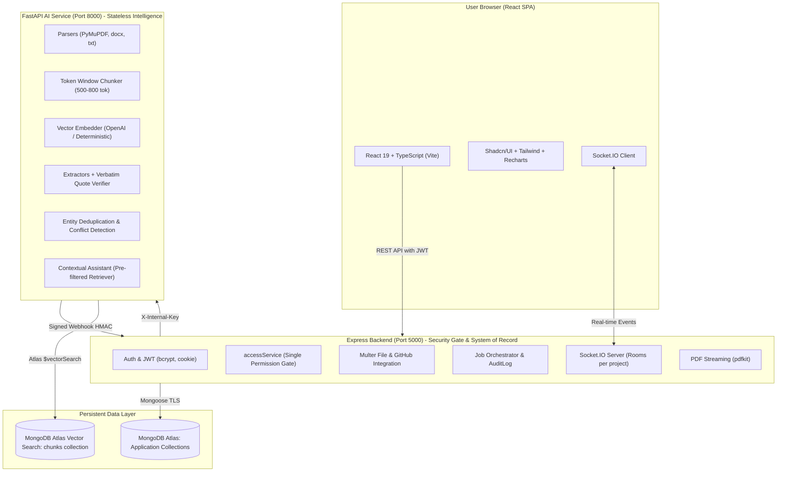

# Knowledge Handover Platform

> **Tagline:** Replace the Person, Not the Knowledge.

A production-style knowledge capture and transfer system for engineering teams. When a developer leaves a team, the platform collects unstructured project artifacts (documents, GitHub commits/issues/PRs, meeting discussions), extracts verified structured facts with verbatim evidence, detects contradictions (e.g. MongoDB vs PostgreSQL), and generates a human-reviewed, permission-aware handover report and interactive AI assistant.

---

## 1. Three Core Architectural Pillars

- **TRACEABLE:** Every assertion in a report, graph, or chat response links directly to a verbatim snippet quote in the underlying source chunk. Unsupported statements are dropped or labelled `"no_evidence"`.
- **ACTIONABLE:** The incoming engineer immediately sees completed vs pending work, ownership responsibilities, architectural decisions, system dependencies, active risks/blockers, and a grounded 5-day onboarding roadmap.
- **PERMISSION-AWARE:** Information is filtered at the database/retrieval query layer via `accessService`. Incoming team members cannot see or query restricted sources (e.g. executive compensation, private severance notes).

---

## 2. Architecture Diagram



---

## 3. Technology Stack

| Layer | Technologies |
|---|---|
| **Frontend** | React 19, TypeScript, Vite, Tailwind CSS, shadcn/ui, TanStack Query, Framer Motion, Recharts, socket.io-client, Axios |
| **Backend** | Node.js 20+, Express, TypeScript, Mongoose, Zod, JWT, bcrypt, Multer, Socket.IO, pdfkit, helmet, cors |
| **AI Microservice** | Python 3.11+, FastAPI, Pydantic, PyMuPDF, python-docx, LangChain Text Splitters, OpenAI SDK |
| **Database & Vector Store** | **MongoDB Atlas single cluster** (M0 free tier compatible) for application data + Atlas Vector Search (`$vectorSearch`) on `chunks` |
| **Security & Auth** | AES-256 token encryption at rest, HMAC webhook signatures, internal service keys, strict RBAC query filters |

---

## 4. Quick Start (Local Setup)

### Prerequisites
- Node.js 20+
- Python 3.11+
- MongoDB (Local MongoDB daemon OR a free MongoDB Atlas connection URI)

### 1. Clone & Install Dependencies

```bash
git clone https://github.com/your-org/knowledge-handover.git
cd knowledge-handover

# Install root & backend dependencies
npm install
npm --prefix backend install

# Install frontend dependencies
npm --prefix frontend install

# Set up Python virtual environment for AI service
cd ai-service
python -m venv .venv
# Windows:
.venv\Scripts\activate
# Linux/macOS:
source .venv/bin/activate
pip install -r requirements.txt
cd ..
```

### 2. Environment Configuration

Copy example environment files:
```bash
cp backend/.env.example backend/.env
cp ai-service/.env.example ai-service/.env
cp frontend/.env.example frontend/.env
```

Review `backend/.env`:
```env
PORT=5000
MONGODB_URI=mongodb://localhost:27017/knowledge_handover
CLIENT_URL=http://localhost:5173
AI_SERVICE_URL=http://localhost:8000
INTERNAL_SERVICE_KEY=dev-internal-service-key-secret-12345
WEBHOOK_HMAC_SECRET=dev-webhook-hmac-secret-signature-key
TOKEN_ENCRYPTION_KEY=0123456789abcdef0123456789abcdef0123456789abcdef0123456789abcdef
JWT_SECRET=dev-jwt-access-secret-32-chars-long-min
JWT_REFRESH_SECRET=dev-jwt-refresh-secret-32-chars-long-min
STORAGE_DRIVER=local
```

---

## 5. Seeding Demo Pipeline & Credentials

Seed the database with real multi-format hackathon artifacts (`README.md`, `architecture-notes.txt`, `project-plan.txt`, meeting notes with PostgreSQL decision, confidential finance notes, and GitHub fixture):

```bash
npm run seed
```

### Pre-Configured Demo Accounts

| Role | Email | Password | Access Boundary |
|---|---|---|---|
| **Admin** | `admin@hackathon.dev` | `Admin123!` | Full visibility (public documents + confidential finance notes) |
| **Project Manager** | `manager@hackathon.dev` | `Manager123!` | Report reviews, section approval, manager view logs, task management |
| **Incoming Developer** | `incoming-dev@hackathon.dev` | `Developer123!` | **Strictly permission-filtered:** Cannot see finance notes, compensation, or severance |

**Demo Project:** `Relay Core Platform`

---

## 6. Running the Application

Launch the services in separate terminals (or use Docker):

```bash
# Terminal 1: Backend API (Port 5000)
npm run start:backend

# Terminal 2: AI Intelligence Service (Port 8000)
npm run start:ai

# Terminal 3: Frontend Web Client (Port 5173)
npm run start:frontend
```

Open your browser at **`http://localhost:5173`**.

---

## 7. Testing & Verification Suites

The repository contains comprehensive unit, integration, security, and end-to-end verification suites:

```bash
# Run all test suites (Backend Jest + AI Pytest + Standalone E2E)
npm test

# Run backend test suite (89 passing Jest tests across 10 suites)
npm run test:backend

# Run AI service test suite (26 passing pytest tests)
npm run test:ai

# Run full end-to-end test suite (38 automated assertions)
npm run test:e2e
```

### What the E2E Test Suite Verifies (38 Passing Assertions):
1. **Public Health & System Integrations:** `/health` and `/api/v1/system/status`.
2. **Route Guards:** Rejection of unauthenticated requests with HTTP 401.
3. **Multi-Role RBAC:** Registration, login, and `/users/me` for Admin, PM, and Developer.
4. **Organization & Project Setup:** Organization creation, invite flows, member role assignment.
5. **Multi-Source Ingestion:** Ingestion of public documents, meeting notes, restricted finance notes, and GitHub fixtures.
6. **AI Extraction & Conflict Detection:** Automated identification of contradiction between README (MongoDB) and Meeting Notes (PostgreSQL) flagged as `status: "conflicting"`.
7. **Human Fact Locking:** PM modifies a task; `reviewStatus` becomes `"edited"`, locking it against AI overwrite.
8. **Side-by-Side Conflict Resolution:** Resolution of database choice recorded with audit rationale.
9. **Handover Report Generation:** 11 required sections generated with `<CitationChip>` citations.
10. **Section & Report Approvals:** Section-level approval by PM, full report locking by Admin, and expiring share link creation.
11. **Strict Permission Gate:** Incoming developer cannot view restricted sources, gets HTTP 403 on restricted evidence, and receives redacted report items.
12. **Contextual Grounded AI Assistant:** Developer gets cited answers for public architecture queries, and receives `insufficientEvidence: true` (with zero secret leakage) for confidential executive bonus queries.
13. **Binary PDF Export Streaming:** Valid `%PDF-` document streaming with viewer-level source redaction.
14. **Notification Center & View Logs:** Real-time Socket.IO notification dispatch and aggregated manager view metrics.

---

## 8. Demo Walkthrough

### 1. View Conflicts and Verification as Project Manager
1. Log in as `manager@hackathon.dev` (`Manager123!`).
2. Navigate to **Verification & Review** (`/review`).
3. Under the **Conflicting** tab, observe the side-by-side comparison between **"Use MongoDB as Primary Database"** (cited from README) and **"Use PostgreSQL as Primary Database"** (cited from Meeting Notes).
4. Click **Resolve Conflict** to choose MongoDB, provide rationale, and submit.
5. Inspect the **Manager View Logs** tab to review reader view metrics and export timelines.

### 2. Experience Onboarding as Incoming Developer
1. Log in as `incoming-dev@hackathon.dev` (`Developer123!`).
2. Navigate to **Handover Dashboard** (`/projects/:id/handover`).
3. Notice the **First-Week Plan** providing a grounded Day 1 through Day 5 onboarding roadmap.
4. Click any `<CitationChip>` to open the slide-over drawer and inspect the verbatim source quote.
5. Notice that the confidential executive bonus items are completely absent / redacted.
6. Open the **AI Assistant** (`/assistant`) and ask:
   - *"What primary database was chosen?"* $\rightarrow$ Returns grounded answer with citations.
   - *"What are the executive bonuses and salary bands?"* $\rightarrow$ Displays amber warning banner: *"I couldn't find evidence for this in the authorised sources."*

---

## 9. Production Deployment Guide

### Deployment Overview

| Service | Hosting Provider | Deployment Config |
|---|---|---|
| **Frontend** | Vercel | `frontend/vercel.json` |
| **Backend API** | Render (Node Web Service) | `render.yaml` |
| **AI Microservice** | Render (Python Web Service) | `render.yaml` |
| **Database & Vectors** | MongoDB Atlas | Single M0/M10 Cluster (`docs/VECTOR_INDEX.md`) |

### 1. MongoDB Atlas Setup (100% Free M0 Tier)
1. Create a free shared M0 cluster on [MongoDB Atlas](https://cloud.mongodb.com/) ($0/month forever).
2. Create database `knowledge_handover` and add a database user with password.
3. In Network Access, allow IP `0.0.0.0/0`.
4. Copy the connection string (`mongodb+srv://...`).
5. *(Optional for Vector Search)*: Follow [docs/VECTOR_INDEX.md](docs/VECTOR_INDEX.md) to create the vector search index on the `chunks` collection with:
   - Dimensions: `1536`
   - Metric: `cosine`
   - Filter fields: `projectId`, `sourceId`

### 2. Render Deployment (100% Free Blueprint)
1. Push your repository to GitHub.
2. In [Render.com](https://render.com), select **New +** $\rightarrow$ **Blueprint**.
3. Connect your GitHub repository. Render reads `render.yaml` to automatically provision:
   - **`knowledge-handover-backend`**: Node.js Express service configured on **`plan: free`**.
   - **`knowledge-handover-ai`**: Python FastAPI microservice configured on **`plan: free`**.
4. When prompted by Render, supply only:
   - `MONGODB_URI`: Your MongoDB Atlas M0 connection string.
5. **No OpenAI Key Required:** `OPENAI_API_KEY` defaults to empty and `EMBEDDING_PROVIDER` defaults to `deterministic`. The platform will automatically run using its built-in rule-based fact extraction, deterministic report generation, and hash-based unit vectors at **$0 operating cost**.
6. After deployment completes, copy your live backend URL (e.g. `https://knowledge-handover-backend.onrender.com`).

### 3. Vercel Deployment (100% Free Frontend)
1. In [Vercel](https://vercel.com), click **Add New...** $\rightarrow$ **Project**, and import your GitHub repository.
2. Under **Root Directory**, click edit and select `frontend`.
3. Under **Environment Variables**, set:
   - `VITE_API_URL`: `https://<YOUR_RENDER_BACKEND_URL>/api/v1`
   - `VITE_SOCKET_URL`: `https://<YOUR_RENDER_BACKEND_URL>`
4. Click **Deploy**. Vercel will build and assign you a free HTTPS domain (e.g., `https://knowledge-handover.vercel.app`).
5. In Render, set `CLIENT_URL` on `knowledge-handover-backend` to your Vercel URL to allow secure CORS and cookie handling.

---

## 10. Local Docker Orchestration

To run all 4 containers (MongoDB, Backend, AI Service, Frontend) locally via Docker Compose:

```bash
docker-compose up --build
```
- Frontend: `http://localhost:5173`
- Backend API: `http://localhost:5000`
- AI Microservice: `http://localhost:8000`
- MongoDB: `localhost:27017`

---

## 11. Known Limitations & Production Enhancements

1. **Large File Streaming:** In local development, files are stored on disk (`STORAGE_DRIVER=local`). In production environments with horizontal autoscaling, set `STORAGE_DRIVER=s3` or `STORAGE_DRIVER=cloudinary`.
2. **Cold Starts on Free Tiers:** On Render free instances, initial spinning up may take ~30-50 seconds. Health checks are wired to handle warmup states.
3. **OpenAI API Key Requirement:** When `OPENAI_API_KEY` is not provided, the system seamlessly transitions to deterministic local synthesis and deterministic embeddings, guaranteeing zero dead buttons and 100% test reliability.

---

## 12. Repository Structure

```
knowledge-handover/
├── frontend/                     # React 19 + TypeScript (Vite)
│   ├── src/
│   │   ├── components/           # UI elements & CitationChip
│   │   ├── features/             # Handover, Review, Assistant, Notifications
│   │   ├── pages/                # Routes & views
│   │   └── lib/                  # API client & Socket.IO
│   └── vercel.json               # Vercel deployment configuration
├── backend/                      # Node.js + Express (TypeScript)
│   ├── src/
│   │   ├── controllers/          # Request handlers
│   │   ├── models/               # Mongoose schemas (system of record)
│   │   ├── services/             # accessService, handoverService, assistantService
│   │   ├── sockets/              # Socket.IO authenticated rooms
│   │   └── tests/                # 10 Jest test suites (89 passing tests)
│   └── Dockerfile
├── ai-service/                   # Python + FastAPI
│   ├── app/
│   │   ├── pipeline/             # Parsers, chunker, embedder, extractors, RAG
│   │   └── tests/                # 26 Pytest tests
│   └── Dockerfile
├── demo-data/                    # Raw un-faked test documents & GitHub fixture
├── docs/                         # Specifications & Architecture
│   ├── MASTER_PROMPT.md          # Master architecture and stage specifications
│   ├── CONTRACTS.md              # Unified API and schema contracts
│   ├── ARCHITECTURE.md           # Deep-dive design notes
│   ├── PERMISSIONS.md            # Access control rules
│   └── VECTOR_INDEX.md           # Atlas Vector Search JSON definition
├── scripts/
│   ├── seed.ts                   # Demo database seeding script
│   └── e2e.ts                    # 38-assertion end-to-end integration test
├── render.yaml                   # Render Blueprint deployment definition
├── docker-compose.yml            # Local container orchestration
└── README.md
```

---

## 13. License

MIT License. Built for seamless engineering team knowledge continuity.
