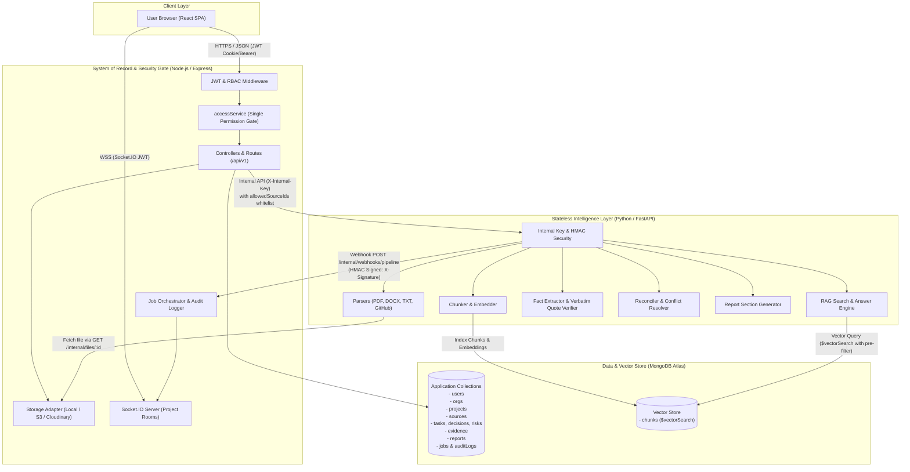

# Architecture Specification

## 1. System Overview

The Knowledge Handover Platform is structured into three isolated application services and a unified database layer:
1. **Frontend:** React SPA built with Vite, TypeScript, Tailwind CSS, TanStack Query, Framer Motion, Recharts, and Socket.IO client.
2. **Backend API:** Node.js + Express (TypeScript), Mongoose, Zod validation, JWT, Multer, Socket.IO, and PDFKit. Acts as the system of record and security gate.
3. **AI Intelligence Service:** Python + FastAPI, Pydantic, OpenAI SDK, PyMuPDF, python-docx, and LangChain splitters. Operates statelessly for extraction, chunking, embedding, reconciliation, and RAG.
4. **Data & Vector Layer:** Single MongoDB Atlas cluster hosting application data collections and the `chunks` collection with Atlas Vector Search (`$vectorSearch`).

---

## 2. Service Architecture & Trust Boundaries

---

## 3. The Knowledge Processing Pipeline

The pipeline follows a single idempotent state machine:

```mermaid
flowchart TD
    subgraph Ingestion ["Per-Source Ingestion"]
        S1["1. Ingest (Express)\nStore file/notes & create Source(uploaded)"] --> S2["2. Parse (FastAPI)\nExtract raw text + locators"]
        S2 --> S3["3. Chunk (FastAPI)\nSplit into 500-800 token chunks"]
        S3 --> S4["4. Embed & Index (FastAPI)\nGenerate vectors & save to Atlas Vector Search\nSource status -> ready"]
    end

    subgraph Analysis ["Project Analysis Job"]
        S4 --> S5["5. Extract Facts (FastAPI)\nStructured tasks, decisions, risks, dependencies\nVerbatim quote validation"]
        S5 --> S6["6. Reconcile (FastAPI)\nDeduplicate & detect contradictions\nAssign AI status: verified | uncertain | conflicting"]
        S6 --> S7["7. Persist (Express)\nWebhook upsert Evidence & Facts by fingerprint\nHuman-edited facts locked"]
        S7 --> S8["8. Draft Report (FastAPI + Express)\nGenerate sections from persisted facts\nValidate evidence citations"]
    end

    subgraph HumanReview ["Human Review & Approval"]
        S8 --> S9["9. Review (Express + UI)\nResolve conflicts, edit facts, approve sections\nStatus: in_review"]
        S9 --> S10["10. Approve & Lock (Express)\nAll sections approved -> status: approved\nImmutable versioned snapshot"]
        S10 --> S11["11. Permission-Aware Share (Express)\nFiltered view via accessService\nExpiring links & audit logs"]
    end

    subgraph RAGAssistant ["Contextual Assistant"]
        S11 --> S12["12. AI Assistant (Express -> FastAPI)\nQuery pre-filtered by allowedSourceIds\nAnswer grounded only in retrieved chunks"]
    end
```

---

## 4. Key Security & Architectural Invariants

1. **Client Isolation:** The browser client communicates exclusively with the Express backend. The FastAPI AI service has no public IP/ingress route in production; all traffic is strictly internal.
2. **Access Control:** All authorization decisions are strictly evaluated in Node.js via `accessService`. The AI service never accesses or interprets role/user permissions; it only receives a sanitized list of `allowedSourceIds`.
3. **Internal Authentication:**
   - Express requests to FastAPI carry `X-Internal-Key: <INTERNAL_SERVICE_KEY>`.
   - FastAPI webhook callbacks to Express carry `X-Signature: sha256=<HMAC>` calculated with `WEBHOOK_HMAC_SECRET`.
4. **Verbatim Quote Verification:** Every extracted claim must provide a quote that matches a verbatim substring of the source chunk (whitespace normalized). Unsupported claims are either dropped or flagged `uncertain`.
5. **Human Lock:** Human approvals or manual edits lock facts from automated AI overwrite on subsequent re-runs.
